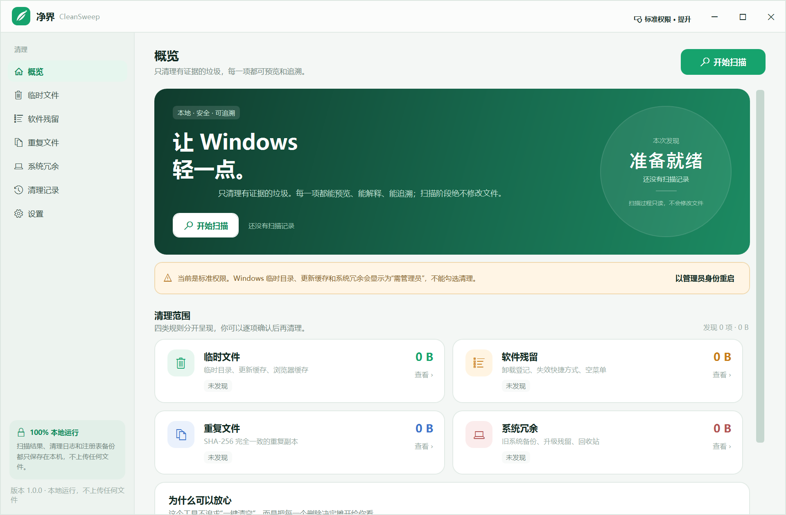

# 净界 CleanSweep

一个**可解释、可追溯**的 Windows 清理工具。它不会“一键清空”，而是先只读扫描、列出每一项、说明删除依据，再由你确认清理。

- **绿色单文件**：`release/CleanSweep/CleanSweep.exe`，约 250 KB，无安装、无 DLL、无外部依赖。
- **界面干净**：四类规则分页展示，支持逐项查看依据、逐项勾选。
- **完全离线**：不发起网络请求，不上传文件名、路径或日志。
- **目标系统**：Windows 10 1903+ / Windows 11（系统自带 .NET Framework 4.8）。



## 快速开始

1. 双击 `release/CleanSweep/CleanSweep.exe`。
2. 点击“开始扫描”。扫描阶段只读，不会修改任何文件。
3. 点击“查看”进入分类，展开“依据”确认路径、时间条件或哈希。
4. 勾选要处理的项目，点击“清理选中项”。
5. 清理完成后查看报告；完整日志在 `%LOCALAPPDATA%\CleanSweep\Logs`。

标准权限即可清理用户级内容。需要处理 `C:\Windows\Temp`、Windows 更新缓存、系统升级残留时，点击右上角“标准权限 · 提升”，以管理员身份重启。

## 清理规则与删除依据

### 1. 临时文件与缓存

| 规则 | 路径 | 条件 | 默认 |
|---|---|---|---|
| 用户临时文件 | `%TEMP%`（通常是 `%LOCALAPPDATA%\Temp`） | 最后修改早于 24 小时 | 勾选 |
| Windows 临时文件 | `%WINDIR%\Temp` | 早于 24 小时，需管理员 | 管理员下勾选 |
| Windows 更新下载缓存 | `%WINDIR%\SoftwareDistribution\Download` | 早于 7 天，需管理员 | 管理员下勾选 |
| 传递优化缓存 | `%WINDIR%\ServiceProfiles\NetworkService\AppData\Local\Microsoft\Windows\DeliveryOptimization\Cache` | 早于 7 天，需管理员 | 管理员下勾选 |
| Windows 错误报告 | `%LOCALAPPDATA%\Microsoft\Windows\WER`、`%PROGRAMDATA%\Microsoft\Windows\WER` | 早于 30 天 | 勾选（系统目录需管理员） |
| 应用崩溃转储 | `%LOCALAPPDATA%\CrashDumps` | 早于 7 天 | 不勾选 |
| 小型内存转储 | `%WINDIR%\Minidump` | 早于 30 天 | 不勾选 |
| 缩略图缓存 | `%LOCALAPPDATA%\Microsoft\Windows\Explorer\thumbcache_*.db` | 早于 7 天 | 勾选 |
| 浏览器缓存 | Chrome / Edge / Brave 的 `Cache`、`Code Cache`、`GPUCache`；Firefox 的 `cache2` | 早于 7 天；浏览器运行中则跳过 | 勾选 |

**依据**：只删除临时/缓存目录中超过阈值且未被占用的文件；不删除目录本身，不跟随符号链接，不触碰系统保护路径。浏览器缓存规则只碰缓存目录，不删除书签、密码、历史记录或 Cookie。

### 2. 软件残留

| 规则 | 判断 | 默认 |
|---|---|---|
| 失效快捷方式 | `.lnk` 的目标为本地路径且已不存在；跳过网络路径、未就绪的可移动磁盘、UWP/MSI 广告快捷方式 | 勾选 |
| 孤立卸载登记 | 卸载登记仍在，但 `InstallLocation` 和 `UninstallString` 指向的本地程序都不存在；MSI 登记一律跳过 | 高置信度项勾选 |
| 疑似卸载登记 | 没有可验证的卸载程序，且安装目录不存在；标为“高风险/疑似”，需要人工确认 | 不勾选 |
| 空开始菜单文件夹 | 开始菜单中完全为空的文件夹 | 不勾选 |

**依据**：快捷方式只移入回收站，不删除目标文件。注册表残留只处理 `...\CurrentVersion\Uninstall` 下的项；删除前先用 `reg.exe export` 导出 `.reg` 备份。MSI 项可能通过 ProductCode 修复，因此完全跳过。厂商/安装路径/卸载程序只要有一项仍存在，就不判定为残留。

### 3. 重复文件

- 扫描范围：桌面、文档、图片、音乐、视频、下载（当前用户目录）。
- 只扫描不小于设置阈值的文件（默认 256 KB）。
- 先按文件大小分组，再对同大小文件做 64 KB 前缀哈希，最后对候选做完整 **SHA-256** 全量比对。
- 只有大小与 SHA-256 都完全一致才归为同组。
- 每组默认保留**修改时间最早**的一份；时间相同则保留路径排序靠前的一份。
- **重复文件组默认不勾选**，避免在浏览临时文件时误清理；进入“重复文件”页勾选整组，或点击底部“全选”。
- 其余副本默认移入**回收站**，可还原。移入回收站不会立即释放磁盘空间，清空回收站后才真正释放。
- 跳过隐藏/系统文件、符号链接、OneDrive 占位文件、`node_modules`、`.git`、`bin`、`obj` 等目录。

**依据**：SHA-256 是内容哈希；大小和完整哈希同时一致，才认为内容相同。报告和日志中会记录完整哈希、保留副本路径。

### 4. 系统冗余

| 规则 | 路径 | 判断 | 默认 |
|---|---|---|---|
| 旧 Windows 安装 | `C:\Windows.old` | 升级回滚备份；10 天后系统通常自动删除 | 不勾选，高风险 |
| 升级临时目录 | `C:\$Windows.~BT`、`C:\$Windows.~WS`、`C:\$WinREAgent`、`C:\$GetCurrent` | 系统升级/恢复环境留下的目录 | 不勾选，高风险 |
| 回收站 | 所有本地驱动器 | Shell 查询到的回收站项目；不可撤销，标记为高风险 | 不勾选 |

**依据**：这些项目由 Windows 升级/恢复流程产生，普通清理不会自动处理。旧系统备份和升级目录标记为高风险；只有管理员可选择，并在确认框中再次确认。删除后会先尝试普通删除，权限不足时通过 `takeown` / `icacls` 修复 ACL 后重试。清空回收站不可撤销。

> **关于“多余的系统工具”**：本工具清理的是系统升级备份、更新缓存、传递优化缓存等**系统冗余产物**，不会自动卸载 Windows 可选组件、驱动或预装应用。自动移除系统组件会破坏服务堆栈和回滚能力，收益与风险不成比例。需要深度组件清理时，请使用 Windows 自带的“磁盘清理”或管理员执行 `DISM /Online /Cleanup-Image /StartComponentCleanup`。

## 安全设计

- **扫描只读**：扫描线程不调用删除 API；只有点击“清理选中项”并完成确认后才执行清理。
- **默认不激进**：崩溃转储、系统升级残留、回收站、疑似注册表残留默认不勾选。
- **路径边界**：每个待删除项都带有扫描时记录的允许根目录；清理前再次校验，禁止删除根目录、系统保护目录、网络路径或符号链接目标。
- **永不跟随重解析点**：目录遍历和删除都会跳过 junction / symlink。
- **可逆优先**：快捷方式和重复文件移入回收站；注册表项先导出 `.reg` 备份，再删除。
- **完整审计**：每次运行生成 JSON + 纯文本报告，记录每个路径、依据、结果、错误和备份位置。
- **无网络**：没有 HTTP 客户端、遥测或云服务。

## 数据位置

默认：

```
%LOCALAPPDATA%\CleanSweep\
  settings.json
  Logs\cleanup-yyyyMMdd-HHmmss-fff.json / .txt
  Backups\*.reg
```

如需完全便携，在 `CleanSweep.exe` 同目录放一个空的 `portable.flag` 文件，数据会改存到 `CleanSweepData\`。

## 构建

需要 .NET SDK（能编译 `net48`）和 .NET Framework 4.8 Targeting Pack：

```powershell
dotnet build .\CleanSweep\CleanSweep.csproj -c Release -o .\release\CleanSweep
```

输出只有一个 `CleanSweep.exe`，不会生成 `.exe.config` 或 DLL。

自检（在临时目录创建样本，验证重复分组、路径保护、文件遍历、清理日志后自动清理样本）：

```powershell
.\release\CleanSweep\CleanSweep.exe --self-test
# 结果：%TEMP%\CleanSweepSelfTest-result.txt
```

## 已知限制

- 重复文件只扫描当前用户的六个常用文件夹，不扫描整块磁盘；隐藏/系统文件、符号链接和 OneDrive 占位文件会跳过。
- 浏览器缓存只在对应浏览器未运行时扫描；关闭浏览器后重新扫描即可。
- MSI 卸载登记不处理，避免破坏 Windows Installer 的修复/卸载信息。
- Windows.old / 升级残留的删除可能较慢，且需要管理员权限；删除后不能回滚到旧版本。
- 移入回收站的项目只有清空回收站后才释放空间；报告会分别统计“直接释放”和“移入回收站”。
- 工具不自动更新，也不会在后台运行。

## 规则参考

- [BleachBit Features](https://www.bleachbit.org/features) — 开源清理工具的分类与清理器设计思路。
- [Microsoft Learn: Delivery Optimization reference](https://learn.microsoft.com/en-us/windows/deployment/do/waas-delivery-optimization-reference) — 传递优化缓存的作用与可重建性。
- [Microsoft Support: 释放 Windows 中的驱动器空间](https://support.microsoft.com/zh-cn/windows/%E9%87%8A%E6%94%BE-windows-%E4%B8%AD%E7%9A%84%E9%A9%B1%E5%8A%A8%E5%99%A8%E7%A9%BA%E9%97%B4-85529ccb-c365-490d-b548-831022bc9b32) — 临时文件、Windows.old、回收站等系统清理入口。
- [Microsoft Q&A: Removing Windows.old](https://learn.microsoft.com/en-ie/answers/questions/5863540/removing-windows-old) — Windows.old 的回滚保留期与删除风险说明。
- [FIPS 180-4 / SHA-256](https://csrc.nist.gov/pubs/fips/180-4/upd1/final) — 重复文件使用的 SHA-256 标准。

## 目录结构

```
CleanSweep/
  Models/       扫描项、重复组、日志、设置
  Services/     四类扫描器、清理器、路径安全、注册表备份、回收站
  ViewModels/   主视图模型、选择与清理流程
  Views/        概览、分类、重复文件、日志、设置、确认/报告窗口
  Themes/       颜色、控件样式、字体
  Assets/       应用图标
release/
  CleanSweep/
    CleanSweep.exe
    README.txt
    SHA256.txt
    screenshots/overview.png
screenshots/
  overview.png
README.md
```
